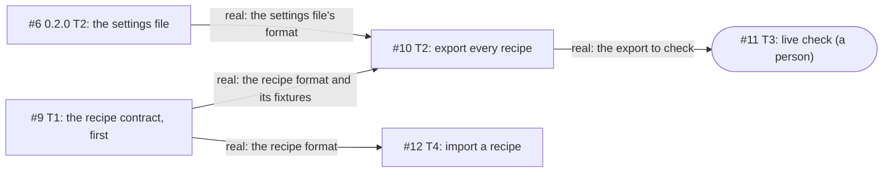

# Plan graph

Turn a confirmed grill into a **spec**, then into a **plan graph** (the spec's tickets and the "blocked by" arrows between them), and get the user's approval for the whole graph at once. It is Matt Pocock's `to-spec`, then his `to-tickets`, as one flow, with two pauses for the user: the spec first, then the graph. The orchestrator runs it.

The user's approval is what launches the graph's fleet: each ticket starts as soon as its blockers have merged, and merges by the project's merge rules in `docs/agents/fleet.md`.

## Before you start

- **The project's settings,** in `docs/agents/` (written by the `setup` skill): `issue-tracker.md` for how the project uses GitHub, `triage-labels.md` for the label names, `domain.md` for where the glossary, ADRs and grills live, and `fleet.md` for the merge rules. If they are missing, run `setup` first.
- **A confirmed grill.** If it is still open, finish it with the `grill` skill first.

## Private records and public decisions

Read the development tracker and private repository from `docs/agents/issue-tracker.md`, and the private checkout and record paths from `docs/agents/domain.md`. Verify the private repository is private before saving exact replies there. Work from its clone for private files and PRs; explicitly target its repository for record comments. A failed or ambiguous read stops the write.

Writers use the public forms in [open-development.v1](../../contracts/open-development.v1.md) on both repositories. Save each exact confirmation or approval first in a private issue/PR comment, with what it answered, and read it back. For a public subject, use the private issue titled exactly `Private record: OpenWiz #<N>` (create on first use); for a private subject use a comment there; for a standing approval use `Private record: standing approvals`. Preserve the words byte for byte there only. A pointer is its full ClosedWiz `issues/<N>#issuecomment-<C>` or `pull/<N>#issuecomment-<C>` URL, with positive numbers and no leading zeroes. It must resolve to the comment holding the words, never to a file or a public comment.

The public confirmation/approval has the existing opening, a one-line decision in your own plain words and its date; its very next line is `Private record: <pointer>`. Its decision contains no double quote marks, and the whole comment carries no quoted exact words, blockquoted replies or thread ids. Under a standing approval, name that approval in the decision and point to the private comment where it was given. Preserve the approval table, revision number, fingerprint and revision text. Public proposal summaries and decision-request JSON must also carry no private replies or thread ids; copy their exact displayed public wording, not the private grill's replies. Grill decision requests remain on the private grill PR. This routing changes no decision schema or fingerprint algorithm.

## Where things go

| What | On the configured development tracker |
| --- | --- |
| The version | A milestone named after it, for example `0.3.0`, made when its grill starts and never before (the `grill` skill makes it), so an idea for later has no number yet |
| The spec | An issue in that milestone. Its body holds the spec and nothing else |
| Each ticket | A sub-issue of the spec, in the same milestone, with GitHub's own "blocked by" links |
| The proposal, the confirmation and each approval | Comments on the spec issue, never edited once posted |

Notes on progress go in comments too, never in a body. So an edit to the body of the spec or of a ticket is always a change to the plan, with one exception: a ticked task box, which the revision reads as unticked ("Is an approval current?"), so a box ticked out of habit stops nothing.

## 1. Read

- **The confirmed grill,** every round of it in the configured private repository, plus the public glossary and ADRs (where `docs/agents/domain.md` says).
- **The code the spec will touch,** so the plan starts from how things are today.
- **The versions before it,** when you plan ahead: the specs and tickets of every earlier version still being built or planned (see "Across versions").

Every decision in the spec comes from the grill, the glossary, an ADR or the code. The grill already interviewed the user, so this step only gathers. A decision that none of them settles goes back to the user as a grill round (the `grill` skill), before the spec is written.

Done when you can point at the grill line, ADR or file behind every decision you are about to write.

## 2. Write the spec

1. **Find the seams:** the places where tests will check the work. Prefer seams that already exist, as high up as possible, and as few as possible: one is ideal. They go in the spec's Testing Decisions, and the user confirms them with the spec.
2. **Write the spec** from the template below, in the glossary's words, keeping to the ADRs.
3. **Publish it** as an issue in the version's milestone, which its grill made when it started (if it is missing, make it now). Give it no label: the spec is not a ticket.

Done when the spec issue is in the milestone and every section of the template is filled (Live check only when the spec needs one).

## 3. Pause: the user confirms the spec

1. **Show the user the spec in at most 10 lines,** its changelog headline word for word among them, with the issue's link, and ask them to confirm it. Post its `spec_confirmation` decision record as below. Confirming the spec settles its headline.
2. **If they change something,** edit the spec's body and show it again.
3. **When they confirm,** save and read back their exact words in the private comment, then post the public "spec confirmed" comment with its decision, date and pointer. Then resolve its decision record as below.

The tickets wait for that comment. Done when it is posted.

## 4. Propose the tickets

Cut the work the way Matt's `to-tickets` does:

- **Tracer bullets.** Each ticket is a narrow but complete path through every layer the work crosses (for example data, server, page and tests), never one layer on its own. When it is done, it works and can be shown or checked by itself.
- **One fresh context window.** Each ticket is small enough for one builder to hold all of it at once.
- **Clean-up first.** Any change that makes the rest easier ("make the change easy, then make the easy change") is its own ticket, and blocks the tickets it helps.
- **Wide refactors** are the one exception to tracer bullets: a mechanical change, like renaming something used everywhere, that would break the whole code base in one go. Expand first (add the new form beside the old), then move the code over in batches, one ticket each, blocked by the expand, then contract (remove the old form) in a ticket blocked by every batch.

Then add ours:

- **Contract first.** Each spec opens with one small **contract-first ticket** that writes the future shape: the contract, types, schemas, fixtures, and stubs with tests that later tickets fill in, within the repository's test rules. It blocks the tickets that rely on it, each with a real link naming what it uses, and after it the rest build side by side. Only a spec with no shared interface skips it, and the proposal says so.
- **Owned paths.** Give each ticket the files and folders it may change; they are for scheduling only. Tickets own different files by rule. A small shared file, where each ticket changes only its own lines (a row, a section; for example `docs/agents/fleet.md`, `STATUS.md` or the CI workflow), is marked `(shared)` in each ticket's Owned paths, with what its lines are, and those tickets run at once with no arrow: whichever merges second fixes the merge conflict. Sharing a file is never by itself a reason for an arrow.
- **Arrows only for real links.** A ticket is blocked only by the exact tickets it cannot start without, never by a whole spec or version. An arrow may point at a ticket in another spec, or in an earlier version (see "Across versions"). Every arrow is a **real link**: the later ticket needs a behaviour the earlier one makes, and its reason names that behaviour. A **file link** (the two only share files) is the exception, drawn only when the files can't be split or shared as above, and the proposal says why for each one. The goal is zero file links; real chains stay as long as they need to be.
- **Link reasons.** Each ticket's `## Links` section gives every one of its native blockers one reason line, in the plan links contract's form (`contracts/plan-links.v1.md`): `- #<n> real: <the behaviour needed, in words>` or `- #<n> file: <the shared files, in backticks>`, or exactly `none` when nothing blocks it. Blockers outside the spec need their lines too. GitHub's native links still decide when a ticket can start; the lines only say why.
- **Contracts, not code.** When a ticket builds on what another one makes, it depends on a **contract**: a file that pins down the shared interface (an API's routes, a file format), agreed before either is built. List it under the ticket's **Relies on**. Every Relies on declaration is exactly one `**Relies on:**` line: comma-separated full repository-relative contract-file paths in backticks, or exactly `nothing`; no prose, partial names, folders or patterns. Name the actual interface file (a skill's rules or report-format file counts), never just its skill name or issue number; put explanatory provenance elsewhere. If the contract does not exist yet, the ticket that writes it blocks every ticket that relies on it. A ticket relies on what the interface says, never on how another ticket builds it.
- **Proof.** Each ticket names the spec's Proof claims it proves, and how.
- **A person's ticket.** Work only a person can do (a live run on the user's machine, an acceptance) is a ticket too, marked as one, so the graph shows it.

Then show it:

1. **Post the "proposed plan graph" comment** on the spec issue: a picture of the graph (GitHub draws the `mermaid` block, on a phone too), each arrow labelled with its reason, a short table with each ticket's links, and the measures: its **longest chain** (the most links on one path of arrows, blockers outside the spec included) and **how many tickets can start at approval** (no open blocker then). Measures, not targets: there is no cap on either. Name each file link with why its files can't be split, and say so if the spec skips its contract-first ticket.
2. **Send the user its link and the table,** with one round of at most three questions: is each ticket the right size, are the arrows right, and is anything missing? Drop any question the grill already settled.
3. **Change the proposal on their answers** and show it again, until they accept it.

Done when the user has accepted the proposal.

## 5. Write the tickets

1. **Create each ticket** from the ticket template, blockers first, so every arrow points at a real issue number and every `## Links` line names its blocker's number. Give it the spec as its parent and its blockers as GitHub's own "blocked by" links, with no label yet (commands below).
2. **Read the graph back from GitHub** (commands below) and compare it with the accepted proposal. Check every ticket's Relies on declaration, and the graph's link reasons, as below, before asking for approval. Fix any difference on GitHub, then read and check it again.
3. **Post the "plan graph written" comment:** the picture and the table, as read back, now with issue numbers, and the link checker's text report. Post its `plan_approval` decision record as below. Send the user its link, and say what approving does: every ticket starts as soon as its blockers have merged, and merges by the project's merge rules.
4. **If the user changes something,** change it on GitHub, read the graph back, and post the comment again. A change to the spec itself goes back to step 3 first.

Done when every ticket has its parent, its milestone and its links, and the graph read back from GitHub matches what the user accepted.

## 6. Record the approval

1. **Wait for a clear approval** of this graph, such as "approve" or "approved". A "looks good" that also asks for a change, or a reply about something else, is not one: make the change, or ask again.
2. **Record it first.** Read and check every ticket's Relies on declaration and the graph's link reasons again, as below; a failed read or check stops here, with no approval record or ready labels. Take the **revision** and its fingerprint (see "Is an approval current?" below), read the graph back for the table, then save and read back the exact approval in its private comment, then post the public "plan graph approved" comment: the decision, date and pointer, the revision's number (1 at the first approval, then 2, 3, … for the same spec), the table, the fingerprint and the revision text. **Before labelling or handing over, validate the posted table:** `sh "<this skill's folder>/scripts/check-approval.sh" <spec>` must pass, using the absolute folder of this loaded SKILL.md and keeping the consumer project's working directory; a failure stops handoff until the latest record is corrected. This validates the public form as well as the table, in addition to the fingerprint check below. A positive `gh repo view --json isPrivate` read permits historical private quoting records only on a private repository; unknown or unread visibility is treated as public. Pointer syntax is checked here; the orchestrator must separately read the private comment and verify its words and subject.
3. **Then label every ticket in it,** with the label its row names: `ready-for-agent`, or `ready-for-human` for a person's ticket (their names here are in `docs/agents/triage-labels.md`). The record comes first, so no ticket is ever ready without an approval behind it. Resolve the added decision record only after the existing approval is recorded and validated.
4. **Read the labels back.**
5. **Hand over to the `launch-fleet` skill:** its next check starts every ticket whose blockers have all merged.

Done when the approval comment is on the spec issue and is current, every ticket in its table has exactly the label its row names, none has `held`, and no other ticket of the spec has a ready label.

## Decision records

Add one structured request per spec confirmation or plan approval request, following [decisions.v1](../../contracts/decisions.v1.md) and its [schema](../../contracts/decisions.v1.schema.json). All existing human-readable proposal, confirmation and approval comments remain immutable; **only the added decision JSON block may be updated** for its lifecycle. This is the narrow exception to "never edited once posted" above. A decision record grants no approval, ready label, handoff or live-run authority.

1. **Spec confirmation.** On showing the spec, post one `spec_confirmation` on its spec issue. Copy the exact displayed 1–10 summary lines and the spec's changelog headline word for word (`none` for infra). `spec` is the actual positive issue number; `tickets` and `graph` are empty arrays, since confirmation precedes planning. A correction supersedes this request before posting the newly displayed one. Only after the existing "spec confirmed" comment saves a clear confirmation may this request become `resolved`; tickets still wait for that comment.
2. **Plan approval.** When the graph is written and read back, post one `plan_approval` on the spec issue. Copy the exact displayed 1–10 summary lines from its latest `spec_confirmation` record, and the spec's changelog headline word for word (`none` for infra); do not truncate. A missing, unread or conflicting source stops the request. Read every current sub-issue and its exact title and native blockers, checking each read and pagination count. Sort ticket rows by number and each unique blocker list ascending, with no self blocker. Derive `graph` only from that table: unique edges sorted by blocker then ticket, including external prerequisites. Compute the fingerprint from `sh <this skill's folder>/revision.sh <spec> > revision.txt` followed, only on success, by `sha256sum revision.txt` (macOS: `shasum -a 256 revision.txt`). It is the existing revision-v2 hash including every newline and existing task-box normalization, never v1, canonical request JSON or a table-only hash. Check that the table and exact displayed proposal still match those source inputs before posting; a failed read or a changing revision stops the request.
3. **Common posting.** Allocate and read back a repository-unique ASCII letter/digit/underscore/hyphen `id` starting with a letter or digit; never reuse it for a different request. Include exactly the schema keys, `schema: openwiz.decisions.v1` and `status: open`. Classify `risk` explicitly as `ordinary`, `live`, `release`, `publish` or `unknown`, never by a default or a guessed title/label; unknown disables answering and live/release/publish need a second cockpit confirmation. For `spec_confirmation` only, hash canonical UTF-8 JSON removing only `fingerprint`, `status` and `answered`: recursive ASCII key order, unchanged array order and raw Unicode, decimal integers, no whitespace or final newline, quotes/backslashes and C0 controls escaped (short escapes where defined, otherwise lowercase `\u00xx`), `/` unescaped.
4. **Post and read back.** Use one separate comment containing exactly one column-zero JSON fence (three backticks plus `json`, then the request object, then three backticks): `gh issue comment <spec> --body-file record.md`. Use the project's repository and privacy rules. Read the returned GitHub comment id back; check subject, unique request id, exact schema fields, fingerprint and current source/displayed wording. A failed or uncertain post/read stays unresolved; inspect before retrying rather than creating duplicate requests. The fixtures below are synthetic examples, never reusable live ids or source data.
5. **Lifecycle only.** Only the orchestrator edits the added JSON block by its exact GitHub issue-comment id, preserving all surrounding prose. Read back every update. Mark `resolved` only after the existing clear confirmation/approval is saved and its checks succeed; an accepted, sent or uncertain send or a closed issue never suffices. Preserve the Relies on checks, revision/currentness check, posted-table validation, record-before-label order and hold-first reapproval flow. Before a changed plan is shown for approval (including the changed/held-ticket flows), supersede the old decision record and post a replacement with the full current graph, summary and headline. Changed summary, headline or risk needs replacement even if the revision hash is unchanged. Never mutate id, kind, fingerprint or proposal fields for progress; only `status` changes. Unread or conflicting records and duplicate ids remain unresolved. A stale fingerprint never starts tickets, and replacing this request never replaces the existing approval record.

**Independent currentness.** Preserve the existing human records. The request cannot attest its own currentness: neither its schema, its fingerprint nor reading back that same block establishes a match to independent source wording. Even a matching revision-v2 hash does not establish the exact displayed summary or risk. U5 must report `current` unknown wherever independent exact summary/headline/risk wording cannot be checked; an unknown check never authorizes an answer. Do not add a currentness field to the request or rewrite the human record to make the request validate itself.

Synthetic spec output before planning (all values invented):

```json
{
  "schema": "openwiz.decisions.v1", "kind": "spec_confirmation",
  "id": "synthetic-spec-confirmation-1", "status": "open",
  "fingerprint": "bfac458ed95fb59543496d86344bb8b428f5a72a2bdbde3b20081ce7cbd51bc1", "risk": "ordinary", "spec": 901,
  "summary": ["Show the synthetic decisions.", "You can inspect synthetic requests."],
  "headline": "You can inspect synthetic requests.", "tickets": [], "graph": []
}
```

Synthetic plan output, matching the revision below:

```json
{
  "schema": "openwiz.decisions.v1", "kind": "plan_approval",
  "id": "synthetic-plan-approval-1", "status": "open",
  "fingerprint": "c9496df55b579a22cf23d7f3f0f05bb0c4c25a6b60174f1e4118f85c65ff6ac7", "risk": "ordinary", "spec": 901,
  "summary": ["Read synthetic requests, then show synthetic cards."],
  "headline": "You can inspect synthetic requests.",
  "tickets": [{"number": 902, "title": "Synthetic reader", "blockers": [900]}, {"number": 903, "title": "Synthetic cards", "blockers": [902]}],
  "graph": [{"blocker": 900, "ticket": 902}, {"blocker": 902, "ticket": 903}]
}
```

### Synthetic plan revision

```text
plan-graph revision v2
spec #901 body sha256 1111111111111111111111111111111111111111111111111111111111111111
ticket #902 blocked-by #900 body sha256 2222222222222222222222222222222222222222222222222222222222222222 title Synthetic reader
ticket #903 blocked-by #902 body sha256 3333333333333333333333333333333333333333333333333333333333333333 title Synthetic cards
```

These body hashes are invented fixture inputs; the request fingerprint is the calculated SHA-256 of these exact revision bytes, including the last newline. This proves a fixture shape and binding, never a live approval.

## Is an approval current?

An approval covers one **revision**: the spec's body, and each of its tickets' number, blockers, body and title, exactly as they were when the user approved. `launch-fleet` must ask this before it starts any ticket of the spec. Ask it yourself after every approval.

1. **Find the spec's latest approval:** its last comment that starts `**Plan graph approved by`.
2. **Take the revision as it is now:** `sh revision.sh <spec> > now.txt` (`revision.sh` is beside this skill), then `sha256sum now.txt` (on macOS, `shasum -a 256 now.txt`). That hash is the fingerprint.
3. **Compare it with the approval's `Fingerprint:` line.** The same: the approval is current. Different, or no approval at all: it is stale, so start nothing under this spec until the user approves the plan as it now stands. To see what changed, compare `now.txt` with the approval's revision text.

The revision text, version 2, is exactly these lines, each ending in a newline:

```text
plan-graph revision v2
spec #<spec> body sha256 <hash>
ticket #<n> blocked-by <#a #b, or none> body sha256 <hash> title <title>
```

- One `ticket` line for each sub-issue of the spec, in number order. Its blockers are in number order, separated by spaces.
- A `<hash>` is the SHA-256, in lowercase hex, of what `gh issue view <n> --json body --jq '.body'` prints (the body, then one newline), with every ticked task box read as unticked: on each line that starts with spaces or tabs (or none), a `-`, `*` or `+`, then spaces or tabs, an `[x]` or `[X]` followed by a space, a tab, a carriage return or the line's end becomes `[ ]`. Nothing else changes: a box's words, its bullet and its indent all count.
- Labels, comments, a ticket's state (open or closed), its milestone and whether its boxes are ticked are not in it. So labelling (a hold included), progress notes, ticked boxes and merges never make an approval stale; any change to the plan does.
- **An approval recorded under version 1** (its revision text starts `plan-graph revision v1`) is stale: no version 2 text can match its fingerprint, even for the same plan. The user must re-approve: record the next revision as in step 6, with "Changed since revision <N>: the revision text's version, v1 to v2", plus any real change the two texts show.

## Changing an approved graph

Any change to the plan after an approval needs the user's approval again: a ticket added or dropped, an arrow added or removed, or an edit to the spec's body or to a ticket's title or body. **Hold first, then change,** so the five-minute loop never starts a changed ticket under its old approval, even if it checks between two of your steps.

1. **Hold the tickets the change touches.** Put the `held` label on each one that has no builder yet and take its ready label off, in one edit, then read the labels back and check: `held` on, the ready label off. `held` is the fleet's label for a held ticket (`docs/agents/fleet.md`); if the project has none yet, create it once first (commands below). The tickets it touches:
   - each ticket whose title, body or arrows will change, and each one you will drop;
   - for a change to the spec's body, every ticket of the spec that has no builder yet.

   If you can't tell whether a ticket has a builder, hold it anyway: the labels only decide whether a builder may start, so holding a running ticket stops nothing.
2. **Tell the running builders.** A ticket already being built keeps going: tell its builder what will change, in a comment on its ticket. For a change to the spec's body, tell the builder of every running ticket of the spec.
3. **Then change the plan on GitHub** (commands below), with a `## Links` line for every arrow the change adds and no line left for an arrow it removes. A new ticket gets no label. A dropped ticket leaves the spec, loses its `held` label if it has one, and is closed, with a comment saying why: only a merge closes a ticket that stays in a spec.
4. **Show the user only what changed:** that part of the picture, and the changed rows.
5. **On their approval,** record it as in step 6, with the next revision number and a "Changed since" line. Only then release each held ticket in one edit, its ready label back on and `held` off, label the new ones, and read the labels back.

From step 3 until the new approval, the fingerprint no longer matches, so `launch-fleet` starts nothing under the spec. The hold covers the moments before that, and any loop that only looks at labels. Its `held` label also tells the fleet's view that the ticket is held, not unapproved.

**A ticket held for a changed contract.** When `launch-fleet` holds a ticket because a merge changed a contract it relies on ("contract changed: re-approve"), check that it has `held` and no ready label (fix either, and read them back), read what changed, and, unless it is a wording-only change (next), update the ticket if it needs it and ask the user to re-approve just that ticket. Record it as above, then release it as in step 5, its ready label back on and `held` off: the new revision is what releases the hold.

**A wording-only change (C2).** Jake, 2026-11-05: the orchestrator may assess and release wording-only contract holds under a standing approval ([private record](https://github.com/jparker2006/ClosedWiz/issues/1189#issuecomment-6667706028)). A merge that only rewords a contract, changing no route, field, status, header, bound, limit, write rule or approval rule, needs no re-approval from Jake. Only the orchestrator, never a tick, decides this:

1. **Read the exact contract diff** of the merge the hold names, its contract files only (`gh pr diff <P>`).
2. **Classify it:** wording-only, or an interface or behaviour change. Unsure, mixed or any doubt counts as an interface or behaviour change (fail closed): ask Jake to re-approve, as above. A ticket whose body needs any edit always goes to Jake, however small.
3. **Post the assessment** on the ticket and on its spec: the merge, the contract, the changed lines quoted, and why no ticket changes, then the line `**Released under Jake's standing approval for wording-only contract changes (C2, 2026-11-05)**`.
4. **Hold first, then check the whole cutoff.** The new approval record moves the check's contract cutoff for the whole spec (for a ticket approved on its own, for every contract it relies on) to the record's `createdAt`: every launch-fleet hold under it becomes releasable, and every contract change merged before it stops counting, whether the check has held or noted it yet or not, even one that merges while you work. So first gate every ticket under that cutoff that has a Relies on line and no builder yet, whatever its labels: `held` on and its ready label off, in one edit if either differs, then append `launch-fleet: held manual: C2 check of spec #<S> before its new approval` (for a ticket approved on its own, `#<S>` is that ticket), and read the labels and comments back. The check starts no held ticket, and this newer hold record takes any older ordering hold's release away from the check, so nothing under the cutoff can start or get its ready label back until step 7. A ticket with an unresolved `launch-fleet: release starting` claim, or one that doesn't read back gated: record nothing and take it to Jake. Then list every merge since the latest approval (`FROM`, its `createdAt`; `TO=9999-12-31T23:59:59Z`) and read each one's files with the commands below, and assess as in steps 1 to 3, for every ticket that relies on it, each merge that edited, renamed or deleted a file matching any Relies on line of those tickets, by its new name or its old one; a ticket being built gets launch-fleet's `note` first. Any change that is not wording-only, needs a ticket edit, or a list or file read that fails or errors (its files not read in full, or a rename without its old name): record nothing and release nothing, leave the approval and every hold as they are, and take it to Jake.
5. **Record the approval the check reads:** first read back the private comment holding Jake's standing approval for wording-only contract changes (C2, 2026-11-05), linked above, and verify its words and scope. Use that verified comment's full URL for the immediate `Private record:` line in either public form below. Write a paraphrased decision naming the standing approval, never its exact words. Name every merge step 4 assessed.

For a spec's ticket, take the next revision as in step 6 (the same plan: the fingerprint must still match the latest approval's). Keep the complete table, matching fingerprint and revision text, and the Changed-since statement:

```md
**Plan graph approved by Jake, <YYYY-MM-DD>, revision <N + 1>:** approved under Jake's standing approval for wording-only contract changes (C2, 2026-11-05).
Private record: <the verified private-comment URL for the C2 standing approval>

Changed since revision <N>: none; released under C2 after the wording-only changes in #<P>, #<P>.

<the complete approval table, matching fingerprint and revision text, as in step 6>
```

For a ticket approved on its own, retain its brief, owned paths and Relies on, and name every merge step 4 assessed:

```md
**Approved on its own by Jake, <YYYY-MM-DD>:** approved under Jake's standing approval for wording-only contract changes (C2, 2026-11-05).
Private record: <the verified private-comment URL for the C2 standing approval>

<every assessed merge; the brief, owned paths and Relies on>
```

6. **Re-check up to the record.** Read the record back; once its read-back has its `createdAt`, and no sooner than a minute after that time (so a merge GitHub is still recording is listed), list the merges again with `TO` set to it (a merge at that very second counts, as the check skips it) and read every new one's files: every contract merge up to the cutoff must be one the record names. Any other, or a read that fails or errors: release nothing, keep every step-4 gate in place (put `held` back on any ticket the check has since released, its ready label still off), give running builders the note, and take it to Jake, naming the merges the record covers unassessed: only his re-approval releases those tickets. A merge after the record's `createdAt` still counts for the check, which holds it as usual.
7. **End the gate.** Before either release or restoration, reread the complete hold history, labels, ownership and each hold's release evidence. Identify only this operation's C2 gate by the exact comment id read back in step 4, never by its text alone. Every other gate, including another C2 check's, keeps its own owner. If history, ownership or release evidence is incomplete or ambiguous, keep the ticket gated and take it to Jake. A newer unresolved non-C2 hold remains authoritative: append no older hold record over it and restore no ready label; keep `held` on and ready off, read its record and labels back, end only the identified C2 gate as below, and stop for that ticket. Only after these reads establish that no newer unresolved hold remains may either branch run. A ticket that had no `held` label before step 4, or whose every hold record since its `held` label last went on, other than this C2 check's own gate record, is a launch-fleet contract hold that step 4 assessed: release it directly (never re-append that contract hold, which would hold it again) in one edit, its ready label back on and `held` off, and read the labels back. Any other gated ticket (an ordering, manual or live hold, a plain hold comment, a hold of plan-graph's, or one the check has held again since the record) is never released by C2: re-append the exact text of its latest hold record from before the gate (a legacy ordering line in its structured `launch-fleet: held for ordering: issue #B merges to main` form), keep `held` on and its ready label off, and read it back, so only its own release evidence frees it. Release nothing else: never any other held ticket. To end only the identified C2 gate, post and read back a comment with the standalone first line `C2 gate <comment-id>: ended`, citing these read-backs below it as that gate's release evidence. This creates no new hold record and grants no release of any other condition; each keeps its own release evidence. A stop in step 4 or 6 keeps every gate until Jake answers; then end each one as above, with his re-approval in place of step 4's assessment for the holds it covers.

The merges and their files, from REST in full (GraphQL's changed-file list has no old name of a rename, so it can't show a contract renamed away). Each command saves every page before `jq` reads them, so a failed page stops it; `RELIES` is the tickets' Relies on paths as a JSON list:

```sh
gh api --paginate "repos/{owner}/{repo}/pulls?state=closed&base=main&sort=updated&direction=desc&per_page=100" > merges.json \
  && jq -s --arg from "$FROM" --arg to "$TO" '[(add // [])[] | select(.merged_at != null and .merged_at > $from and .merged_at <= $to) | .number] | sort' merges.json
gh api --paginate "repos/{owner}/{repo}/pulls/<P>/files?per_page=100" > files-<P>.json \
  && jq -s --argjson relies "$RELIES" 'add // [] | if length >= 3000 then error("3000 files or more: not read in full")
    elif any(.[]; (.filename | type) != "string" or .filename == "" or (.status | type) != "string"
             or (.status == "renamed" and ((.previous_filename | type) != "string" or .previous_filename == "")))
    then error("a file without a name, status or old name")
    else [.[] | select(.status != "added") | .filename, .previous_filename | select(. != null)
          | select(. as $f | any($relies[]; . as $p | if endswith("/") then $f | startswith($p)
              elif contains("*") then $f | test("^" + ($p | gsub("(?<c>[.+?^${}()|\\[\\]\\\\])"; "\\\(.c)") | gsub("\\*"; "[^/]*")) + "$")
              else $f == $p end))] | unique end' files-<P>.json
```

The second prints the contract files the merge changed by either name (`[]`: none), matched as the check matches them: a path ending `/` is a folder, and `*` any name within one folder.

Done when the latest approval is current and every held ticket has its ready label back and no `held` label.

## Contract-shaped grants and delegated ON1 evidence

When the approval explicitly adopts [ops-dispatch v1](../../contracts/ops-dispatch.v1.md),
record/check its envelope separately from the existing complete approval table,
revision text and revision-v2 fingerprint. The envelope's exact paths, supporting
purposes, criteria, shared sections, owners and source-recomputed material explain
current authority; they are not a new template field or an alternative plan hash.
No graph approval silently retrofits envelopes into another approved graph.
The ops agent may assess other exact same-intent paths under the current
`narrow-grant` rule, reading the actual diff and source/ownership evidence and
recording a bound intent, grant/refusal/uncertainty and invalidations. The helper
checks evidence, never decides scope. Builders cannot grant their own exceptions.
Protected policies, contracts/interfaces, dependencies, workflows, scope, live and
spending retain their existing gates. Changes to approved bodies, titles, links
or outcomes still use **hold first**, the full successor revision and reapproval.
Follow the consumer project's finite daily audit procedure, resolved through
its private-state settings. The procedure stays in the configured private
repository; never copy it into the skills package.

Delegated ON1 is evidence preparation under the contract, not C2 authority or an
enabled release effect. Before any proposed release, record the approved producer
and verified merge/actual delta; every affected consumer's current approval,
unchanged behaviour and effective paths including valid grants; the exact hold
id/owner/full history; standing rule revision/reference; other gates and competing
claims; and the stable claimed operation. Optional/additive wording alone proves
nothing. Preserve the existing complete plan-revision/table, unchanged fingerprint,
Relies on and link checks and record-before-label order. Gate affected unstarted
consumers before moving a cutoff, and notify running consumers through recorded
work. Assess every outstanding declared-contract delta inclusively through the
new cutoff, including renames/deletions. After recording, re-read the complete
cutoff and hold history; do delayed verification on a later finite wake, never
sleep. Immediately before any separately enabled effect recheck current authority,
all consumers/grants, exact hold ownership, blockers and competing claims. A newer
hold, unread page or uncertain/partial relabel leaves work nonstartable. Restore
only the approved ready role for the exact covered hold and read labels/history
back; release never starts a builder. Under current OB-A1 the actual ops release
remains disabled, even with complete evidence. #2112 owns that consumer.

C2 remains the orchestrator-only wording assessment above, with all its full-cutoff
and hold-ownership checks unchanged. ON1 delegates no C2, CT1, factory-skill,
red-main, live, activation, spending or publication authority. Missing evidence,
changed consumer scope or an unavailable effect boundary records a gap and ends;
new decisions go through the existing exception/reapproval path.

## Across versions

- **Plan as far ahead as useful.** Any version may be grilled, specced and planned whenever it helps, however far ahead of the version being built, against what the versions before it will be once their tickets are done. A far plan stays safe: its tickets point at the exact tickets they need, a changed contract holds them for re-approval, and a changed plan starts nothing until the user approves it again ("Changing an approved graph").
- **Arrows into earlier versions.** A ticket may be blocked by exact tickets of any earlier version, being built or only planned. It starts as soon as those merge, because `launch-fleet` works from every approved graph at once.
- **Releases and live checks stay in order.** Code reaches `main` as soon as it is reviewed, whatever its version. Each version's release branch is cut when its last ticket merges, and live checks and releases run in version order. So a ticket of a later version can merge early, but its version's live check and release wait for the version before it.

## Check Relies on before approval

Use [check-relies.sh](check-relies.sh) on each ticket body read back from the tracker. It reads stdin and the repository's files, writes nothing, and makes no network call. It uses `sh` and `jq`, the existing fleet tools. Run it from the project's root, using the installed skill's path if the skill lives elsewhere:

```sh
# Check the read separately: a failed gh read must not be hidden by a pipeline.
gh issue view <ticket> --json body --jq '.body' > /tmp/ticket-body.md
# Only after that read succeeds:
sh skills/plan-graph/check-relies.sh --root . < /tmp/ticket-body.md
```

Exit 0 means the form passes, 1 means a refused body or path (the reason is on stderr), and 2 means bad arguments. A nonzero result stops the approval: fix the declaration, read it back, and check it again. The same check applies after any change to a ticket or its contracts, before re-approval. For an already approved graph, **hold first**, as in “Changing an approved graph”; never repair a ticket body under the old approval.

The checker requires the inline template line that the fleet reads, outside code blocks and comments. Keep it on one line, with a blank line before the next section or field. Use `**Relies on:** nothing` only when there is no shared interface. Otherwise list exact files, for example:

```md
**Relies on:** `contracts/widget.v1.md`, `contracts/widget.v1.schema.json`, `skills/review-ticket/SKILL.md`
```

A path is relative to the repository root, with `/` separators and ASCII letters, digits, `.`, `_` or `-` in its components; no empty, `.` or `..` component. It must name a file, not a folder, glob, symlink, shortened filename, or prose such as “the review report format (#101)”. This checks the form and resolution only: the orchestrator still verifies that each file defines the interface the ticket needs and that no contract is omitted.

If a contract does not exist yet, verify that its writer owns that exact path and blocks this ticket. Pass each such full path explicitly with `--planned <path>` (repeatable); the check then permits that absent file, not a folder or pattern. For example, a future `contracts/widget.v2.md` needs `--planned contracts/widget.v2.md`. Keep that verification with the proposal. After the writer merges, run the check without that allowance before the dependent starts. A missing or misspelled file is otherwise refused.

## Check link reasons before approval

Run the link checker, `check-links.sh` beside `check-relies.sh`, on the whole spec, beside the Relies on check: when the graph is written (step 5) and before every approval (step 6, and every re-approval). Its form, its report and its exit codes are the plan links contract's (`contracts/plan-links.v1.md`). It reads the `Record authors` row of `docs/agents/fleet.md` from the default branch, then the spec's tickets and their native blockers, through `gh`; it writes nothing and makes no other network call. Run it from the project's root, using the installed skill's path if the skill lives elsewhere:

```sh
sh skills/plan-graph/check-links.sh <spec>
```

Exit 0 passes. Exit 1 refuses, with one `Links:` line per refusal on standard error (a native blocker with no reason line, a line for a ticket that is not a native blocker, two lines for one blocker, a real line that names no behaviour, a file line that names no file, or a malformed section); exit 2 means bad arguments or a failed read. Either stops the step exactly as a Relies on failure does: fix the ticket's `## Links` section, read it back, and run both checks again. For an already approved graph, **hold first**, as in "Changing an approved graph".

A pass still reports every file link (`file link: #<ticket> blocked by #<blocker>: <files>`) and the counts. Put the report in the "plan graph written" comment, and show the user each file link with why its files can't be split, or remove it before asking.

**A graph not yet re-cut** was written before `## Links`, so its links read as unlabelled and the checker refuses it. It gets its reasons at its next approval, whatever that approval is for (a changed ticket, a contract hold or a re-cut): hold its tickets, give each one its `## Links` section, real or file from the code, the contracts and the tickets, and show the user the reasons with the change.

## Commands

GitHub CLI 2.94 or later. `docs/agents/issue-tracker.md` has the rest. Write every body to a file first and pass it with `--body-file`.

```sh
# Before the first write of a session: is this the right repository?
gh repo view --json nameWithOwner

# The version's milestone, made when its grill started; create it only if it is missing
gh api 'repos/{owner}/{repo}/milestones?state=all' --jq '.[] | {number, title, state}'
gh api --method POST 'repos/{owner}/{repo}/milestones' -f title='<version>'

# The spec
gh issue create --title '<version> spec: <name>' --milestone '<version>' --body-file spec.md

# A comment on the spec issue, or on a ticket
gh issue comment <n> --body-file comment.md

# A ticket (leave out --blocked-by when nothing blocks it)
gh issue create --title '<version> <id>: <name>' --milestone '<version>' --parent <spec> --blocked-by <n>,<n> --body-file ticket.md

# Hold tickets before a change: held on and the ready label off, in one edit (then read the graph back).
# First, the held label: this prints held if the project has it; if it prints nothing, create it, once
gh label list --search held --json name --jq '.[] | select(.name == "held") | .name'
gh label create held --description "Held: waits for the user's approval"
gh issue edit <n> <n> <n> --add-label held --remove-label 'ready-for-agent'
gh issue edit <n> --add-label held --remove-label 'ready-for-human'

# Change the spec's body, or a ticket's title, body or arrows
gh issue edit <n> --title '<version> <id>: <name>' --body-file ticket.md
gh issue edit <n> --add-blocked-by <n> --remove-blocked-by <n>

# Drop a ticket: out of the spec, its held label off (if it has one), a comment saying why, then closed
gh issue edit <spec> --remove-sub-issue <n>
gh issue edit <n> --remove-label held
gh issue close <n>

# Read the graph back: how many tickets the spec has (then their numbers), then one table row per ticket
gh issue view <spec> --json subIssues --jq '.subIssues.totalCount, (.subIssues.nodes[].number)'
gh issue list --milestone '<version>' --state all --limit 1000 --json number,title,parent,blockedBy,labels --jq 'map(select(.parent.number == <spec>)) | sort_by(.number) | .[] | "| #\(.number) | \(.title) | \([.blockedBy.nodes[].number | "#\(.)"] | join(", ") | if . == "" then "none" else . end) | \([.labels[].name] | join(", ") | if . == "" then "none" else . end) |"'

# The labels of an approval, one command per label
gh issue edit <n> <n> <n> --add-label 'ready-for-agent'
gh issue edit <n> --add-label 'ready-for-human'

# Release held tickets once the new approval is recorded: the ready label back on and held off, in one edit
gh issue edit <n> <n> --add-label 'ready-for-agent' --remove-label held
gh issue edit <n> --add-label 'ready-for-human' --remove-label held

# The revision: revision.sh runs the subIssues read above, then these two, for the spec and for each ticket
gh issue view <n> --json body --jq '.body'
gh issue view <n> --json number,title,blockedBy --jq '"#\(.number)\t\([.blockedBy.nodes[].number] | sort | map("#" + tostring) | join(" ") | if . == "" then "none" else . end)\t\(.title)"'
```

The read-back is right when it prints one row per ticket, as many as `totalCount` (the first number the `subIssues` read prints). Fewer rows means a ticket is missing from the milestone. Its columns are the ticket, its title, its blockers and its labels. A ticket's blockers may be in another spec or version; they still show by number.

## Templates

**The spec.** Title: `<version> spec: <name>`. Matt's template, plus our **Changelog headline**, **Proof** and **Live check**:

```md
## Problem Statement

The problem the user faces, from the user's side.

## Solution

The solution, from the user's side.

## Changelog headline

The one public sentence this spec makes true, from the user's side, for its version's changelog entry: settled when the user confirms the spec. A spec with no version (infra work, such as CI, tests or a fix to the skills) writes `none`.

## User Stories

A long, numbered list that covers every part of the work:

1. As <an actor>, I want <a feature>, so that <a benefit>.

## Implementation Decisions

The decisions made: the modules built or changed and their interfaces, technical clarifications, architecture, schema changes, contracts, and specific interactions. No file paths or code: they go stale fast. (One exception: a snippet from a prototype that pins a decision down better than words, such as a state machine or a schema, trimmed to the decision and marked as from a prototype.)

## Testing Decisions

What makes a good test here (it checks behaviour from the outside, not how the code does it), what will be tested, the seams, and prior art: similar tests already in the code.

## Proof

| Claim | Evidence |
| --- | --- |
| <id> <what will be true> | <what proves it: a test run red first, a live observation, or a review> |

## Live check

The smallest real test on the user's own machine or account that honestly proves the spec, sized to its risk, and what the user does in it. Only when the spec touches their machine or account; otherwise leave this section out.

## Out of Scope

What this spec does not do.

## Further Notes

Anything else: the grill it came from, sources and credits.
```

**A ticket.** Title: `<version> <id>: <name>`, where `<id>` is short and unique in the version (T1, T2, …; or a letter per spec, A1, B1, when the version has several). Matt's ticket, plus our **Owned paths**, **Relies on**, **Links** and **Proof**. Its blockers are GitHub's own links; its `## Links` section only gives each one its reason, one line per native blocker, or exactly `none`:

```md
## Parent

Ticket <id> of spec #<spec> (<version>).

## What to build

The behaviour this ticket makes work, end to end, from the user's side. No file paths: they go under Owned paths.

## Owned paths

<each file and folder this ticket may change, in backticks; a folder ends in />; a small shared file adds (shared) and the lines this ticket changes>

**Relies on:** <comma-separated full repository-relative contract-file paths in backticks, or exactly nothing>

## Links

- #<n> real: <the behaviour this ticket needs from #<n>, in words>
- #<n> file: <the shared files, in backticks; only when they can't be split>

## Acceptance criteria

- [ ] <criterion>

## Proof

<the spec's Proof claims this ticket proves, and its evidence, red first>
```

A person's ticket adds `## Done by` after Parent: `a person: <who, and what they do>`.

**The picture,** in each graph comment. One box per ticket, an arrow from each blocker to the ticket it blocks, labelled with its reason (`-->|real: …|`, or a dotted `-.->|file: …|` for a file link), a round box for a person's ticket, and a box with its version for a blocker outside this spec. Keep a label short: its words from the reason line, without quotes or `|`. Once the tickets are written, each box starts with its issue number:

````md

````

In the proposal, before any ticket is written, the boxes have no numbers: `T1["T1: the recipe contract, first"]`.

**An approval on its own,** including a standing approval, uses the same public form. Name the standing approval in the decision and retain the brief, owned paths and Relies on below it:

```md
**Approved on its own by <User>, <YYYY-MM-DD>:** <the decision, naming the standing approval when used>
Private record: <the full private-comment URL>

<the brief, owned paths and Relies on>
```

**The comments** on the spec issue, each opening with its bold first line:

```md
**Spec confirmed by <User>, <YYYY-MM-DD>:** <the confirmed decision, in your own plain words>
Private record: <the full private-comment URL>

Next: the proposed tickets, for <User>'s review.
```

```md
**Proposed plan graph,** for <User>'s review. No ticket is written yet.

<the picture>

| Ticket | Delivers | Blocked by | Links | Owned paths | Relies on |
| --- | --- | --- | --- | --- | --- |
| T1: <name> | <the behaviour, in a few words> | <ids, or none> | <one reason per blocker, as its `## Links` line will say: `T1 real: <behaviour>` or `T1 file: <files>`; or none> | <paths, each small shared file marked (shared)> | <backticked full contract-file paths, or exactly nothing> |

Longest chain: <n> links (<the tickets on it>). Can start at approval: <n> of <total>.

File links: <each one, with why its files can't be split; or none>. <Only when the spec has no contract-first ticket: why it has no shared interface.>

Three questions: is each ticket the right size, are the arrows right, and is anything missing?
```

```md
**Plan graph written,** waiting for <User>'s approval. Approving starts every ticket as soon as its blockers have merged, and each one merges by the project's merge rules.

<the picture, with issue numbers>

| Ticket | Title | Blocked by | Labels |
| --- | --- | --- | --- |
<the rows, as read back>

Link check: <the link checker's text report, exactly as it printed it, in a text block>
```

`````md
**Plan graph approved by <User>, <YYYY-MM-DD>, revision <N>:** <the approved decision, in your own plain words>
Private record: <the full private-comment URL>

Changed since revision <N - 1>: <what changed>.

| Ticket | Title | Blocked by | Label |
| --- | --- | --- | --- |
<the rows, as read back just before labelling, each with the label it gets>

Fingerprint: `<the SHA-256 of the revision text>`

<details><summary>Revision text</summary>

```text
<the revision text, exactly as revision.sh printed it>
```

</details>
`````

Leave out the "Changed since" line at revision 1. Every approval lists the whole graph and fingerprints the whole revision, so the latest approval alone says what is approved.

The public decision is your plain account of what was approved, never a quotation. The exact words and any private source context belong only in the linked private comment. Keep the existing opening and revision/table/fingerprint so readers still find the latest approval. On a public or unknown repository, a quoting record is invalid even if an older public record is valid; never fall back to it.

## Licence

Adapted from Matt Pocock's `to-spec` and `to-tickets` skills (`github.com/mattpocock/skills` @ `a496f55`), which carry this notice:

Copyright (c) 2026 Matt Pocock

Permission is hereby granted, free of charge, to any person obtaining a copy
of this software and associated documentation files (the "Software"), to deal
in the Software without restriction, including without limitation the rights
to use, copy, modify, merge, publish, distribute, sublicense, and/or sell
copies of the Software, and to permit persons to whom the Software is
furnished to do so, subject to the following conditions:

The above copyright notice and this permission notice shall be included in all
copies or substantial portions of the Software.

THE SOFTWARE IS PROVIDED "AS IS", WITHOUT WARRANTY OF ANY KIND, EXPRESS OR
IMPLIED, INCLUDING BUT NOT LIMITED TO THE WARRANTIES OF MERCHANTABILITY,
FITNESS FOR A PARTICULAR PURPOSE AND NONINFRINGEMENT. IN NO EVENT SHALL THE
AUTHORS OR COPYRIGHT HOLDERS BE LIABLE FOR ANY CLAIM, DAMAGES OR OTHER
LIABILITY, WHETHER IN AN ACTION OF CONTRACT, TORT OR OTHERWISE, ARISING FROM,
OUT OF OR IN CONNECTION WITH THE SOFTWARE OR THE USE OR OTHER DEALINGS IN THE
SOFTWARE.
